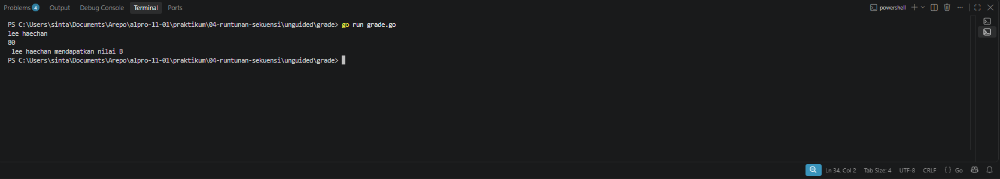
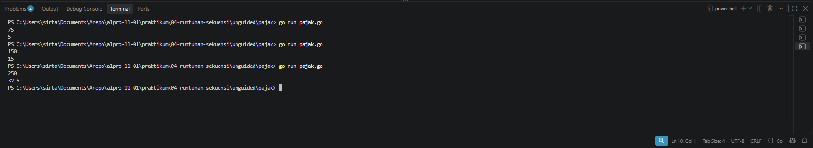

# <h1 align="center">Laporan Praktikum Modul 04 - RUNTUNAN DAN SEKUENSI</h1>
<p align="center"> LINGGA ARKANANTA MAHARDIKA - 109092600012 </p>


## Dasar Teori

### A. Pengertian Runtunan & Sekuensi

Runtunan atau sekuensi adalah salah satu struktur kontrol dasar dalam algoritma pemrograman, di samping struktur percabangan (selection) dan perulangan (looping). Runtunan merupakan satu atau lebih instruksi yang dikerjakan komputer secara berurutan sesuai dengan urutan penulisannya, dari instruksi pertama hingga instruksi terakhir, tanpa ada instruksi yang diulang maupun dilompati. 

Dengan kata lain, setiap instruksi dikerjakan tepat satu kali, mengikuti urutan tulis (top-to-bottom), dan urutan penulisan instruksi sangat menentukan hasil akhir program. Jika urutan instruksi ditukar, maka hasil eksekusi program dapat berubah atau bahkan menjadi salah 


## Guided

### 1. grade.go

```go
package main 

import (
	"bufio"
	"os"
	
	"fmt"
)

func main() {
	var nama string
	var nilai float64
	var grade string

	scanner := bufio.NewScanner(os.Stdin)
	scanner.Scan()

	nama = scanner.Text()


	fmt.Scan(&nilai)

	if nilai >= 90 && nilai <= 100 {
		grade = "A"
	} else if nilai >= 80 && nilai < 90 {
		grade = "B"
	} else if nilai >= 70 && nilai < 80 {
		grade = "C"
	} else if nilai >= 60 && nilai < 70 {
		grade = "D"
	} else {
		grade = "F"
	}

	fmt.Printf(" %s mendapatkan nilai %s\n", nama, grade)

}
```
#### Deskripsi grade.go
Program ini berfungsi untuk menentukan grade mahasiswa berdasarkan nama dan nilai yang diinputkan. Input nama menggunakan bufio Scanner agar bisa membaca nama yang mengandung spasi, sedangkan input nilai menggunakan fmt.Scan. Setelah itu nilai akan dicek melalui kondisi if else untuk menentukan grade A sampai F, kemudian hasilnya akan ditampilkan dalam format nama mendapatkan nilai grade tersebut.


### 2. penilaian.go

```go
package main

import (
	"bufio" 
	"fmt"
	"os"
)

func main() {
	
	var pilihan int
	var nama string
	var nilai float64
	var grade string

	fmt.Println("============= Menu =============")
	fmt.Println("1. Sistem penilaian")
	fmt.Println("0. Keluar")
	fmt.Print("Pilih opsi: ")

	fmt.Scanln(&pilihan)

	if pilihan == 1 {
		fmt.Print("Masukkan nama siswa: ")

		scanner := bufio.NewScanner(os.Stdin)

		scanner.Scan()

		nama = scanner.Text()

		fmt.Print("Masukkan nilai siswa: ")
		fmt.Scanln(&nilai)

		// Menentukan grade nilai
		if nilai >= 90 && nilai <= 100 {
			grade = "A"
		} else if nilai >= 80 && nilai < 90 {
			grade = "B"
		} else if nilai >= 70 && nilai < 80 {
			grade = "C"
		} else if nilai >= 60 && nilai < 70 {
			grade = "D"
		} else {
			grade = "F"
		}

		fmt.Printf("%s mendapatkan nilai %s\n", nama, grade)

	} else if pilihan == 0 {
	
		fmt.Println("Keluar dari program.")

	} else {
		
		fmt.Println("Pilihan tidak valid.")
	}
}
```

#### Deskripsi penilaian.go
Program ini adalah versi pengembangan dari program sebelumnya yang ditambahkan dengan sistem menu. Saat dijalankan program akan menampilkan menu pilihan 1 untuk sistem penilaian dan 0 untuk keluar. Jika pengguna memilih 1, program akan meminta input nama siswa menggunakan bufio scanner agar bisa membaca spasi dan input nilai, kemudian nilai tersebut akan diproses dengan percabangan if else untuk menentukan grade A sampai F dan hasilnya akan ditampilkan. Jika memilih 0 program akan keluar, dan jika memilih selain itu akan muncul pesan pilihan tidak valid.


### 3. klasifikasi.go

```go
package main

import ("fmt"

)

func main() {

	var usia int
	var gaji int
	var keterangan string

	fmt.Scan(&usia)
	fmt.Scan(&gaji)

	switch {
	case usia < 18:
		keterangan = "Masih sekolah"
	case usia >= 18 && usia <= 25 && gaji >= 50:
		keterangan = "Muda sukses"
	case usia >= 18 && usia <= 25 && gaji < 50:
		keterangan = "Masih belajar hidup"
	case usia >= 26 && usia <= 40 && gaji >= 100:
		keterangan = "Pekerja mapan"
	case usia >= 26 && usia <= 40 && gaji < 100:
		keterangan = "Perlu perbaikan karier"
	case usia > 40 && gaji >= 150:
		keterangan = "Profesional berpengalaman"
	case usia > 40 && gaji < 150:
		keterangan = "Perlu evaluasi finansial"
	}

	fmt.Println(keterangan)
}
```

#### Deskripsi klasifikasi.go
Program ini berfungsi untuk menentukan keterangan status seseorang berdasarkan usia dan gaji yang diinputkan. Program akan membaca dua input angka yaitu usia dan gaji, kemudian melakukan pengecekan menggunakan switch case dengan beberapa kondisi usia dan nominal gaji untuk menentukan keterangannya seperti masih sekolah, muda sukses, pekerja mapan, dan seterusnya, lalu hasil keterangan tersebut akan ditampilkan sebagai output.


## Unguided

### 1. `grade.go`

```go
package main 

import (
	"bufio"
	"os"
	"fmt"
)

func main() {
	var nama string
	var nilai float64
	var grade string

	scanner := bufio.NewScanner(os.Stdin)
	scanner.Scan()
	nama = scanner.Text()

	fmt.Scan(&nilai)

	switch {
	case nilai >= 90 && nilai <= 100:
		grade = "A"
	case nilai >= 80 && nilai < 90:
		grade = "B"
	case nilai >= 70 && nilai < 80:
		grade = "C"
	case nilai >= 60 && nilai < 70:
		grade = "D"
	default:
		grade = "F"
	}

	fmt.Printf(" %s mendapatkan nilai %s\n", nama, grade)
}
```

##### Output `grade.go`


#### Deskripsi
Soal ini intinya disuruh ngubah program grade yang lama pakai if-else jadi wajib pakai switch. Jadi tujuan utamanya biar paham kalau switch di Go itu bisa cek kondisi, bukan cuma cek nilai yang sama persis. Cara kerjanya program ini baca satu baris input contohnya Lee Haechan 88, nah bagian penting di code ada di strings.Fields(input) itu buat mecah input jadi kata-kata, terus parts[len(parts)-1] itu kita anggap sebagai nilai karena pasti angka, dan strings.Join(parts[:len(parts)-1], " ") itu sisanya kita gabung lagi jadi nama. Ini trik biar nama yang ada spasinya gak kepotong. Terus masuk ke inti soalnya yaitu switch { case nilai >= 85: grade = "A" }, kenapa pakai switch kosong tanpa variabel? itu namanya switch true jadi dia bakal ngecek tiap case yang isinya kondisi boolean dari atas ke bawah. Urutannya harus dari yang paling gede dulu contohnya >= 85 dulu baru >= 70, kalau kebalik nanti nilai 88 malah kejebak di >= 70 duluan dan hasilnya jadi salah. Contoh eksekusinya kalau input 88 maka dia akan lewat case pertama false, terus ketemu case nilai >= 70 itu true jadi grade diisi B.

### 2. `perhitungan_pajak.go`

```go
package main

import "fmt"

func main() {
	var penghasilan float64
	var pajak float64

	fmt.Scan(&penghasilan)

	if penghasilan <= 50 {
		pajak = 0.05 * penghasilan
	} else {
		if penghasilan <= 100 {
			pajak = (0.05 * 50) + (0.10 * (penghasilan - 50))
		} else {
			if penghasilan <= 200 {
				pajak = (0.05 * 50) + (0.10 * 50) + (0.15 * (penghasilan - 100))
			} else {
				pajak = (0.05 * 50) + (0.10 * 50) + (0.15 * 100) + (0.20 * (penghasilan - 200))
			}
		}
	}

	fmt.Println(pajak)
}
```

##### Output `pajak.go`


#### Deskripsi
perhitungan_pajak.go itu pakai float64 biar bisa nampung koma contohnya 32.5, kalau pakai int ilang komanya.Terus pakai nested if biar pajaknya kepotong bertingkat. Kalau penghasilan <= 50 ya udah 0.05 _ penghasilan doang.Kalau lewat 50 masuk ke else terus cek lagi if penghasilan <= 100, rumusnya  (0.05 _ 50) + (0.10 _ (penghasilan - 50)). Contoh 75 itu jadi 2.5 + (25 _ 10%) = 5.Kalau lewat 100 masuk lagi ke if penghasilan <= 200, rumusnya (0.05 _ 50) + (0.10 _ 50) + (0.15 _ (penghasilan - 100)). Contoh 150 itu 2.5 + 5 + (50 _ 15%) = 15.Kalau lewat 200 baru masuk else terakhir rumusnya (0.05 _ 50) + (0.10 _ 50) + (0.15 _ 100) + (0.20 _ (penghasilan - 200)). Contoh 250 itu 2.5 + 5 + 15 + (50 * 20%) = 32.5.Terakhir fmt.Println(pajak) buat nyetak hasilnya.


## Kesimpulan

Pada praktikum ini telah dipelajari implementasi struktur percabangan if-else dan switch sebagai metode pengambilan keputusan berdasarkan kondisi. Pada studi kasus penentuan grade nilai mahasiswa, percabangan digunakan untuk mengklasifikasikan nilai numerik menjadi kategori huruf A, B, C, D, F dengan batasan rentang tertentu. Pembelajaran ini menunjukkan bahwa switch dengan kondisi case dapat menjadi alternatif yang lebih terstruktur dan mudah dibaca dibandingkan if-else berantai, dengan hasil logika yang tetap identik.Pada studi kasus perhitungan pajak progresif, diterapkan percabangan bersarang atau nested if sesuai dengan instruksi tugas. Materi ini memberikan pemahaman mengenai perhitungan bertingkat dimana penghasilan dibagi ke dalam beberapa lapisan tarif yaitu 5% untuk 0-50 juta, 10% untuk 50-100 juta, 15% untuk 100-200 juta, dan 20% untuk di atas 200 juta. Penggunaan tipe data float64 menjadi krusial untuk menjaga presisi nilai desimal pada hasil perhitungan pajak.Secara umum, praktikum ini juga memberikan pemahaman mengenai manajemen input output pada Go, khususnya pentingnya konsistensi penggunaan buffer input. Penggunaan bufio.Scanner secara konsisten untuk membaca os.Stdin lebih direkomendasikan dibandingkan mencampur metode Scanner dan fmt.Scan untuk menghindari konflik buffer, sehingga proses input nama dan nilai dapat berjalan secara sekuensial sesuai alur program yang diharapkan.

## Referensi

1. JURNAL MODUL 04

2. MODUL 4