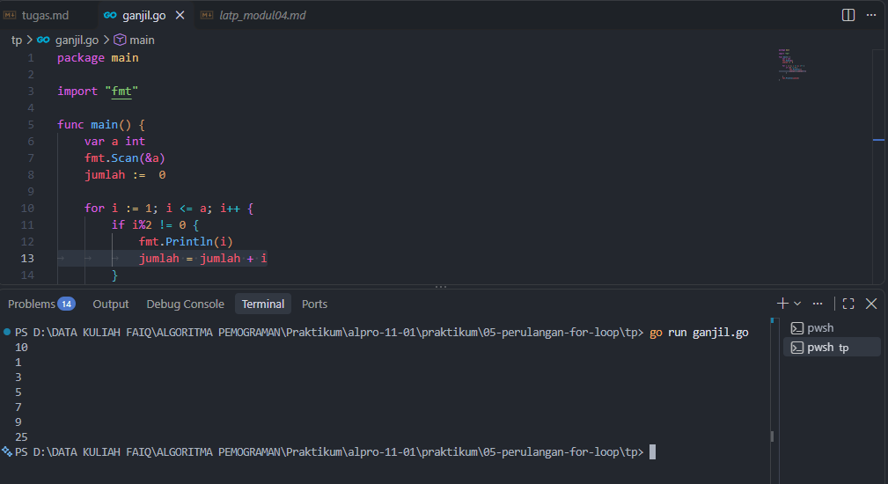
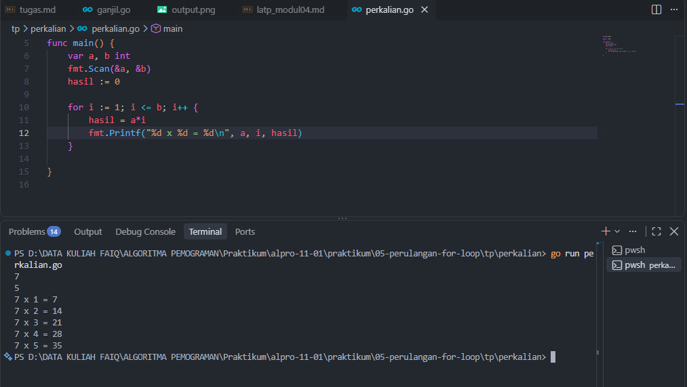

# <h1 align="center">Tugas Pendahuluan Modul 05 - “PERULANGAN FOR” </h1>
<p align="center">LINGGA ARKANANTA MAHARDIKA - 109092600012</p>

### 1. ganjil.go

```go
package main

import "fmt" 

func main() {
	var a int
	fmt.Scan(&a)
	jumlah :=  0

	for i := 1; i <= a; i++ {
		if i%2 != 0 {
			fmt.Println(i)
			jumlah = jumlah + i
		}
	}
	fmt.Println(jumlah)
}

```

##### Output
<!-- Path relatif dari readme.md ke folder unguided/[nama_soal]/output.png, contoh: -->



#### Deskripsi
Menampilkan seluruh angka ganjil mulai dari 1 hingga i, lalu dilakukan perjumlahan kepada kesuluruhan angka ganjil

### 2. evaluasi_pernyataan.go

```go
package main

import "fmt"

func main() {
	var a, b int
	fmt.Scan(&a, &b)
	hasil := 0

	for i := 1; i <= b; i++ {
		hasil = a*i
		fmt.Printf("%d x %d = %d\n", a, i, hasil)
	}

}

```

##### Output
<!-- Path relatif dari readme.md ke folder unguided/[nama_soal]/output.png, contoh: -->



#### Deskripsi
menampilkan hasil dari perkalian variabel a dan b.


## Kesimpulan
Keempat soal ini melatih penggunaan percabangan dalam Go. Soal 1 dan 2 menunjukkan bahwa hasil sebuah kondisi ditentukan oleh operator perbandingan (>, ==, dst.) dan operator logika (&&, ||, !), serta urutan evaluasinya, sehingga alur program dan nilai akhir variabel bisa dilacak secara manual. Soal 3 dan 4 menerapkan switch case untuk memilih tindakan berdasarkan nilai tertentu, seperti menentukan jumlah hari dalam sebulan (termasuk tahun kabisat) dan indeks nilai. Secara keseluruhan, pemahaman kondisi if dan switch membuat program mampu mengambil keputusan sesuai input yang diberikan