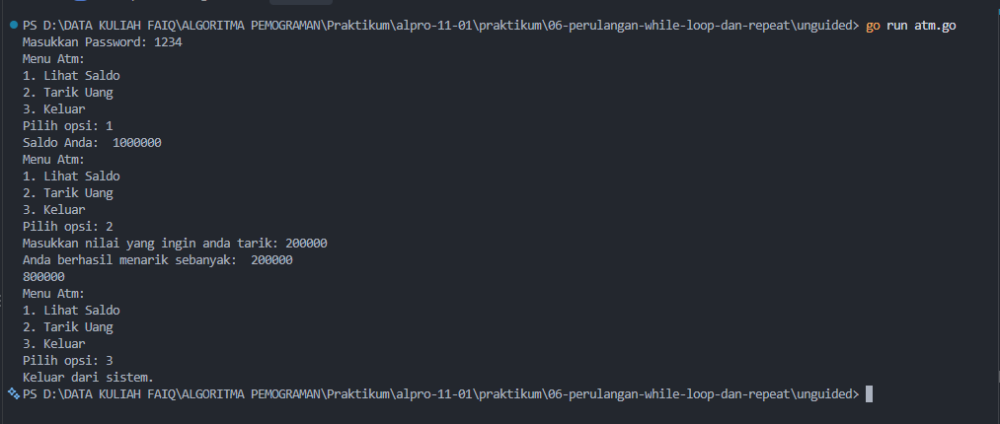

# <h1 align="center">Laporan Praktikum Modul 05 - Variabel dan Operator</h1>
<p align="center">LINGGA ARKANANTA MAHARDIKA - 109092600012</p>

## Dasar Teori

### A. Perulangan For di Go
Perulangan for menjalankan perintah yang sama secara berulang tanpa menulis kode berkali-kali, dan merupakan satu-satunya perulangan di Go. Bentuk tiga komponennya adalah for inisialisasi; kondisi; post statement { ... }: inisialisasi dijalankan sekali di awal, kondisi dicek sebelum tiap putaran, dan post statement dijalankan setelah tiap putaran

### B. For Hanya Kondisi dan Perulangan Bersarang
Karena Go tidak punya yang namanya while, perannya digantikan oleh for yang hanya berisi kondisi. for juga bisa diletakkan di dalam for lain (perulangan bersarang) untuk memproses data yang tiap itemnya punya beberapa nilai


## Guided

### 1. terkecil.go

```go
package main

import "fmt"

func main() {
    var batas int
    fmt.Scan(&batas)

    n := 1
    for n*n*n <= batas {
        n++
    }

    fmt.Println(n)
}

```
#### Deskripsi
Program yang menggunakan perulangan while untuk mencari bilangan bulat terkecil n sehingga n^3 lebih besar dari yang diinput

### 2. terbesar.go

```go
package main

import "fmt"

func main() {
    var batas int
    fmt.Scan(&batas)

    n := 1
    for n*n < batas {
        n++
    }

    fmt.Println(n - 1)
}

```
#### Deskripsi
Program yang menggunakan perulangan while untuk menentukan bilangan bulat terbesar n sedemikian rupa sehingga n^2 kurang dari batas yang diinput

### 3. vokal.go

```go
package main

import (
    "bufio"
    "fmt"
    "os"
    "strings"
)

func main() {
    reader := bufio.NewReader(os.Stdin)
    kalimat, _ := reader.ReadString('\n')

    i := 0
    jumlahVokal := 0

    for i < len(kalimat) {
        ch := strings.ToLower(string(kalimat[i]))
        if ch == "a" || ch == "i" || ch == "u" || ch == "e" || ch == "o" {
            jumlahVokal++
        }
        i++
    }

    fmt.Println(jumlahVokal)
}

```
#### Deskripsi
Program meminta pengguna memasukkan sebuah kata atau kalimat, lalu program akan menghitung berapa banyak huruf vokal (a, i, u, e, o) yang terdapat dalam kata atau kalimat yang diinput


## Unguided

### 1. atm.go

```go
package main

import (
	"fmt"

)

func main() {
	var pilihan, tarikSaldo int 
	var password int = 0
	var saldo int = 1000000
	n := 3

	for i := 1; i <= n; i++ {
		fmt.Print("Masukkan Password: ")
		fmt.Scan(&password)
		if password == 1234 {
			for {
				fmt.Println("Menu Atm: ")
				fmt.Println("1. Lihat Saldo")
				fmt.Println("2. Tarik Uang")
				fmt.Println("3. Keluar")			
				fmt.Print("Pilih opsi: ")
				fmt.Scan(&pilihan)

				if pilihan == 1 {
					fmt.Println("Saldo Anda: ",saldo)
				} else if pilihan == 2 {
					fmt.Print("Masukkan nilai yang ingin anda tarik: ")
					fmt.Scan(&tarikSaldo)
					fmt.Println("Anda berhasil menarik sebanyak: ",tarikSaldo)
					saldo = saldo - tarikSaldo
					fmt.Println(saldo)
				} else if pilihan == 3 {
					fmt.Println("Keluar dari sistem.")
					break
				} else {
					fmt.Println("Pilihan tidak valid")
					break
				}
			}
			break

		} else {
			if i == n {
				fmt.Print("Rekening anda telah blokir.")
			} else {
				fmt.Printf("Password salah. Silahkan coba lagi.\n")
			}
		}


	}
}

```

##### Output
<!-- Path relatif dari readme.md ke folder unguided/[nama_soal]/output.png, contoh: -->



#### Deskripsi
Program yang menyimulasikan atm dengan skenario berikut:
- program meminta password untuk bisa mengkases sistem
- pengguna diberikan maksimal 3 kali untuk memasukkan password yang benar
- jika password benar, program akan menampilkan sistem atm, jika tetap salah sampai 3 kali berturut-turut program akan menampilkan "rekening anda dibloki"


## Kesimpulan
Praktikum ini melatih penggunaan perulangan for untuk mengulang proses sesuai kebutuhan, seperti menjumlahkan data, mencari nilai terbesar, dan menghitung transaksi. Perulangan juga bisa digabung dengan percabangan dan perulangan bersarang untuk mengolah data yang lebih komplek

## Referensi
1. Google. ([2026]). *[The Go Programming Language Documentation]*. [Mountain View]: [Google]. Diakses pada [27 september 2026] melalui [[tautan/DOI](https://go.dev/doc/)]
2. [Donovan, A. A. A., & Kernighan, B. W.]. ([2015]). *[The Go Programming Language]*. [Boston]: [Donovan, A. A. A., & Kernighan, B. W.]. Diakses pada [27 september 2026] melalui [[tautan/DOI](https://www.gopl.io/)]
<!-- Tambahkan nomor referensi berikutnya sesuai kebutuhan -->
