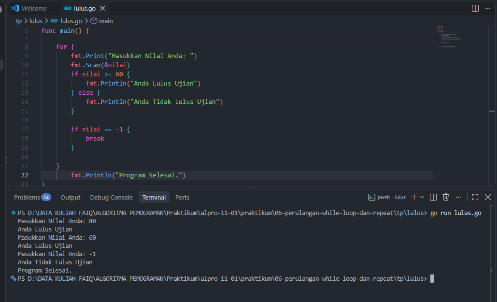
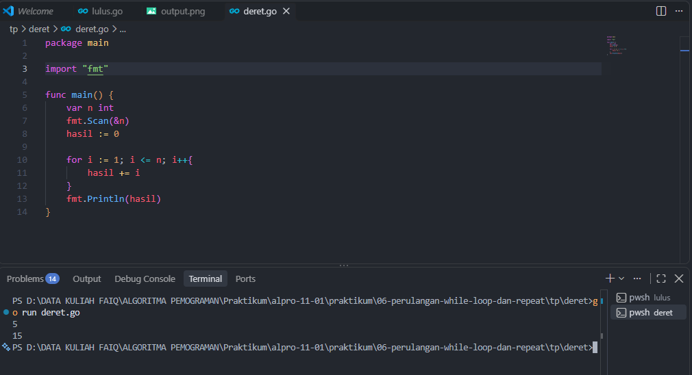
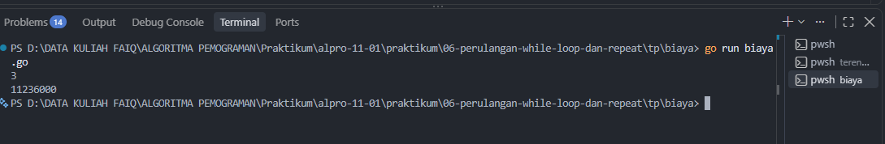

# <h1 align="center">Tugas Pendahuluan Modul 06 - “PERULANGAN WHILE”</h1>
<p align="center">LINGGA ARKANANTA MAHARDIKA - 109092600012 </p>

### 1. lulus.go

```go
package main

import "fmt"

func main() {
	var nilai int

	for {
		fmt.Print("Masukkan Nilai Anda: ")
		fmt.Scan(&nilai)
		if nilai >= 60 {
			fmt.Println("Anda Lulus Ujian")
		} else {
			fmt.Println("Anda Tidak Lulus Ujian")
		}

		if nilai == -1 {
			break
		}

	}
		fmt.Println("Program Selesai.")
}
```

##### Output


#### Deskripsi
Program ini membaca nilai ujian terus-menerus dan mencetak lulus kalau nilainya 60 ke atas. Kalau yang dimasukkan -1, program berhenti.

### 2. deret.go

```go
package main

import "fmt"

func main() {
	var n int
	fmt.Scan(&n)
	hasil := 0

	for i := 1; i <= n; i++{
		hasil += i
	}
	fmt.Println(hasil)
}
```

##### Output


#### Deskripsi
Program ini menjumlahkan 1 sampai n. Angka i dimulai dari 1 lalu ditambahkan ke jumlah sampai i lebih besar dari n.

### 3. duaterendah.go

```go
package main

import (
	"fmt"
	"math"
)

func main() {
	var n int
	fmt.Scan(&n)

	var nama1, nama2 string
	nilai1, nilai2 := math.MaxInt, math.MaxInt

	i := 0
	for i < n {
		var nama string
		var nilai int
		fmt.Scan(&nama, &nilai)

		if nilai < nilai1 {
			nilai2, nama2 = nilai1, nama1
			nilai1, nama1 = nilai, nama
		} else if nilai < nilai2 {
			nilai2, nama2 = nilai, nama
		}
		i++
	}

	fmt.Println(nama1)
	fmt.Println(nama2)
}
```

##### Output


#### Deskripsi
Program ini mencari dua siswa dengan nilai paling kecil. Setiap kali ada nilai yang lebih kecil, data dua nilai terendah diperbarui, lalu namanya dicetak di akhir.

### 4. biaya.go

```go
package main

import "fmt"

func main() {
	var n int
	fmt.Scan(&n)

	biaya := 10000000.0
	tahun := 1
	for tahun < n {
		biaya = biaya * 1.06
		tahun++
	}

	fmt.Printf("%.0f\n", biaya)
}
```

##### Output


#### Deskripsi
Program ini menghitung biaya kuliah tahun ke-n. Biayanya dikali 1,06 tiap tahun, lalu dicetak dibulatkan dengan `%.0f`.

## Kesimpulan
Di Go tidak ada `while`, jadi perulangannya ditulis pakai `for` yang hanya berisi kondisi. Bentuk ini enak dipakai kalau jumlah putarannya belum pasti, misalnya membaca input sampai -1. Di keempat soal, perulangan ini dipakai untuk membaca nilai, menjumlah deret, mencari dua nilai terendah, dan menghitung kenaikan biaya.