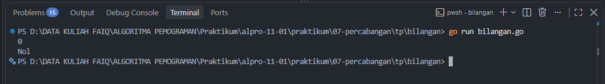
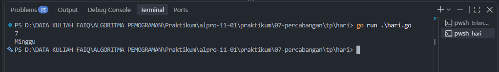
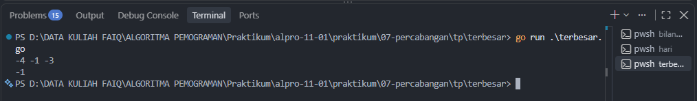

# <h1 align="center">Tugas Pendahuluan Modul 06 - “PERCABANGAN” </h1>
<p align="center">LINGGA ARKANANTA MAHARDIKA - 109092600012</p>

### 1. bilangan.go

```go
package main 

import "fmt"

func main() {
	var n int 
	fmt.Scan(&n)


	if n == 0 {
		fmt.Print("Nol")	
	} else if n%2 == 0 {
		fmt.Print("genap, ")
		if n >= 1 {
			fmt.Print("positif")
		} else if n < 0 {
			fmt.Print("negatif")
		}
	} else if n%2 != 0 {
		fmt.Print("ganjil, ")
		if n >= 1 {
			fmt.Print("positif")
		} else if n < 0 {
			fmt.Print("negatif")
		}
	}

}

```

##### Output
<!-- Path relatif dari readme.md ke folder unguided/[nama_soal]/output.png, contoh: -->



#### Deskripsi
Program yang menerima bilangan bulat lalu menentuka nilai tersebut genap, ganjil atau nol. Lalu juga menentukan positif dan negatif

### 2. hari.go

```go
package main 

import "fmt"

func main() {
	var hari int
	fmt.Scan(&hari)

	switch hari {
	case 1:
		fmt.Println("Senin")
	case 2:
		fmt.Println("Selasa")
	case 3:
		fmt.Println("Rabu")
	case 4:
		fmt.Println("Kamis")
	case 5:
		fmt.Println("Jumat")
	case 6:
		fmt.Println("Sabtu")
	case 7:
		fmt.Println("Minggu")	
	default :
		fmt.Println("Hari tidak diketahui")			
	}				
}

```

##### Output
<!-- Path relatif dari readme.md ke folder unguided/[nama_soal]/output.png, contoh: -->



#### Deskripsi
Program yang menerima nomor lalu menyesuaikan nya dengan nomor hari, misal 1 = senin atau 7 = minggu, jika no yang dimasukkan lebih dari tujuh maka output nya "hari tidak diketahui".


### 3. terbesar.go

```go
package main 

import "fmt"

func main() {
	var x, y, z int
	fmt.Scan(&x, &y, &z)

	if x > y {
		fmt.Println(x)
	} 
	if y > x {
		fmt.Println(y)
	} 
	if z > y {
		fmt.Println(z)
	}
}

```

##### Output
<!-- Path relatif dari readme.md ke folder unguided/[nama_soal]/output.png, contoh: -->



#### Deskripsi
Program yang menentukan bilangan yang paling besar dari ke tiga angka yang diinput.


## Kesimpulan
Ketiga soal ini melatih dalam melatih logika percabangan.